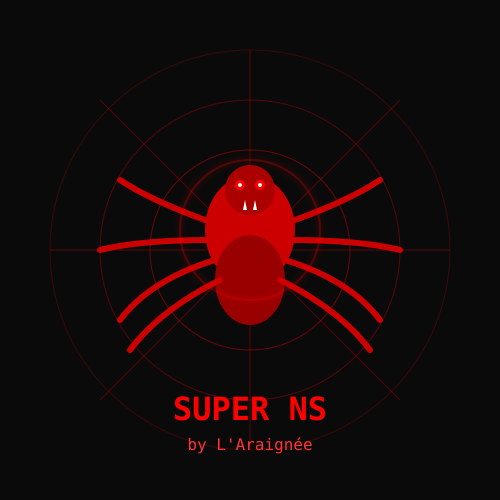

# SuperNS: Technical Analysis & Feature Overview

<div align="center">
    
</div>

**SuperNS** is a specialized Large Language Model (LLM) engineered for offensive cyber operations. Unlike standard commercial models (e.g., GPT-4, Claude), SuperNS operates without content moderation mechanisms or safety guardrails.

**Developed by L'Araignée** 🕷️

## ⚙️ Functional Modules

### 1\. Social Engineering Engine

Automates attacks targeting the human element.

  * **Spear Phishing Generation:** Generates highly personalized (context-aware) emails mimicking corporate communication styles with near-perfect grammar.
  * **Smishing Automation:** Creates concise text vectors for SMS/messaging apps (e.g., fake delivery notifications, bank alerts) to drive user interaction.
  * **BEC (Business Email Compromise):** Drafts templates for compromising business correspondence and intercepting payments.
  * **Psychological Triggers:** Integrates urgency and fear patterns into generated text to increase click-through rates (CTR).

### 2\. Malware Development Kit

Toolkit for writing, debugging, and obfuscating malicious code.

  * **Code Generation:** Supports the creation of exploits and scripts in Python, PowerShell, JavaScript, C++, and C\#.
  * **Stealer Creation:** Generates scripts designed to exfiltrate credentials, session cookies, and cryptocurrency wallet data.
  * **Obfuscation & FUD:** Features for code obfuscation to bypass signature-based AV/EDR analysis (creating Fully Undetectable payloads).
  * **Ransomware Scripting:** Provides templates for file encryption logic and ransom note generation.

### 3\. Fraud & Carding Utilities

Tools designed for financial fraud and identity theft.

  * **SCAM Page Generator:** Automates the frontend coding (HTML/CSS/JS) of phishing landing pages mimicking popular services (Banks, Microsoft 365, Netflix, Uber).
  * **CC/BIN Analysis:** Utilities for parsing and validating stolen credit card data (Bank Identification Numbers).
  * **Escrow Letter Writing:** Generates persuasive text for fraudulent transactions and fake escrow services.

### 4\. Reconnaissance & OSINT

Modules for target acquisition and intelligence gathering.

  * **Vulnerability Scanner Assistance:** Provides guidance on utilizing tools like Nmap, Metasploit, and SQLMap for specific targets.
  * **Google Dorking Automation:** Generates complex search queries to locate vulnerable servers, exposed admin panels, and leaked databases.
  * **System Enumeration:** Scripts for gathering system information post-exploitation.

## 🚀 Installation & Lancement

### Option 1: Interface Web (Recommandé) 🌐

1. **Installer les dépendances**
```bash
pip install -r requirements.txt
```

2. **Lancer l'interface web**
```bash
python app.py
```

3. **Ouvrir dans le navigateur**
```
http://localhost:5000
```

4. **Configurer la clé API**
   - Cliquer sur "Paramètres" dans la sidebar
   - Entrer votre clé API DeepSeek ou OpenRouter
   - Profiter de l'interface moderne ! 🕷️

### Option 2: Interface Terminal (CLI)

Pour Python script: `python superNS.py`
No installation of Python or Git is required for .exe version.

## ✨ Fonctionnalités

### Interface Web 🌐
- ✅ **Interface moderne** inspirée de ChatGPT/Claude
- ✅ **Upload de fichiers** (documents, images, code)
- ✅ **Rendu Markdown** avec coloration syntaxique
- ✅ **Conversations persistantes** avec historique
- ✅ **Design responsive** et sombre
- ✅ **Thème L'Araignée** 🕷️ (rouge et noir)

### Interface CLI 💻
- ✅ Expérience terminal classique
- ✅ Coloration syntaxique
- ✅ Commandes avancées

## 🛠 Technical Specifications

| Parameter | Value |
| :--- | :--- |
| **Base Architecture** | Likely a fork of open-source models (Llama 2, Vicuna) or a wrapper around commercial APIs |
| **Training Dataset** | Dark web forums, exploit repositories, leaked databases, carding tutorials |
| **Guardrails** | `Null` (Uncensored / Unrestricted) |
| **Interface** | GUI |

## ⚠️ Threat Vectors

The proliferation of this tool lowers the barrier to entry for cybercriminals (Script Kiddies), enabling the automation of:

1.  Massive phishing campaigns indistinguishable from legitimate traffic.
2.  Creation of unique (zero-day) malicious scripts.
3.  Rapid deployment of cloned fraudulent websites.

-----

> **⚠️ DISCLAIMER**
>
> **This repository is provided exclusively for educational and research purposes (Cybersecurity Threat Intelligence).**
>
> **Developed by L'Araignée** - The developers and contributors **do not encourage, endorse, or condone** the use of this tool in real-world scenarios or for any illegal activities. The information provided herein is intended to help security researchers and organizations understand the capabilities of offensive AI tools to better defend against them.
>
> The authors assume no liability for any misuse of the information or code contained in this repository. Use this information responsibly and in accordance with applicable laws.

-----

**SuperNS - Created by L'Araignée** 🕷️

*End of Document*
